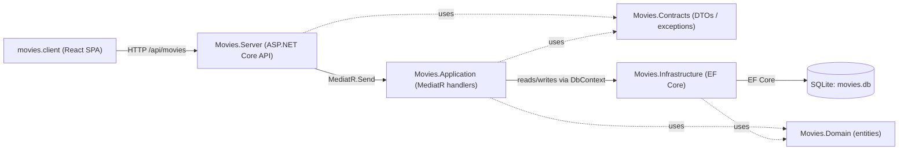

# Architecture

This repo has five components with a non-trivial request → handler → database data
flow, so it clears the `docs/architecture.md` threshold in
`conventions/repo-documentation.md`.

## Diagram

Solid arrows are runtime call/data flow; dashed arrows are compile-time
type/reference dependencies (shared DTOs and domain entities).

## Components

- **Movies.Server** — ASP.NET Core minimal-API host. Maps the `/api/movies` HTTP
  routes, configures Swagger, CORS, and the global exception-handler middleware,
  and proxies to the `movies.client` SPA dev server via
  `Microsoft.AspNetCore.SpaProxy`.
- **Movies.Application** — Business logic and validation. Defines MediatR
  commands/queries and their handlers for CRUD operations, a `ValidationBehavior`
  pipeline step backed by FluentValidation, and the Mapster mapping configuration.
- **Movies.Contracts** — Shared DTOs (`MovieDto`), request/response models
  (`CreateMovieRequest`, `UpdateMovieRequest`, `GetMoviesResponse`, ...), and
  custom exception/error types (`NotFoundExecption`, `CustomValidationException`,
  `ValidationError`) referenced by both `Movies.Server` and `Movies.Application`.
- **Movies.Domain** — Domain entities, notably `Movie` (and a shared `BaseEntity`).
- **Movies.Infrastructure** — Data access via `Microsoft.EntityFrameworkCore` and
  `Microsoft.EntityFrameworkCore.Sqlite`; owns `MoviesDbContext` and the EF Core
  migrations.

`movies.client` (the React/Vite SPA) is external to the .NET solution and is
described from the API's point of view under Integration points below.

## Data flow

An HTTP request from `movies.client` (or any other API client) hits a route
mapped in `Movies.Server`. The endpoint dispatches a MediatR command or query
into `Movies.Application`, whose handler validates the request (via the
FluentValidation pipeline behavior), performs the operation against
`MoviesDbContext` in `Movies.Infrastructure`, and returns a result that
`Movies.Server` serializes back to the client. Domain entities
(`Movies.Domain`) and shared DTOs/exceptions (`Movies.Contracts`) flow through
every layer; unhandled/known exceptions are converted to `ProblemDetails`
responses by `Movies.Server`'s `ExceptionHandler`.

## External integration points

- **Database** — SQLite, accessed through EF Core (`Microsoft.Data.Sqlite` /
  `Microsoft.EntityFrameworkCore.Sqlite`). Connection string name:
  `ConnectionStrings:DbConnectionString` (see README § Configuration for the
  name; never the value).
- **Frontend React app** (`movies.client`) — consumes the `/api/movies` HTTP
  endpoints exposed by `Movies.Server`; proxied together in local dev via
  `Microsoft.AspNetCore.SpaProxy` and Vite's dev-server proxy config.

## Operational notes / gotchas

- CORS policy (`AllowReactApp` in `Movies.Server/Program.cs`) is hardcoded to a
  single origin (`https://localhost:58292`) rather than read from
  configuration — update it when deploying against a different frontend origin.
- The SQLite connection string (`ConnectionStrings:DbConnectionString`, flagged
  sensitive) is configured as a relative file path resolved against the process
  working directory rather than an absolute path — verify it before running
  outside local dev.
- `Movies.Server/movies.db` (and its `-shm`/`-wal` sidecar files) are committed
  to the repository; treat as sample/dev data only, not a place to store real or
  sensitive data.

No `docs/adr/` directory exists in this repo yet.

---
schema_version: 1.0.0
distilled_from_sha: a805589550ccc625d4a0e40842cfe5dc6268b879
verified_sha: a805589550ccc625d4a0e40842cfe5dc6268b879
verified_at: 2026-08-16T16:20:15Z
